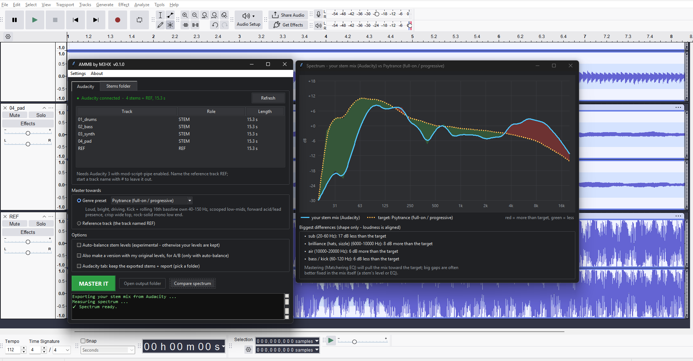

# AMMB by M3HX — Audacity Auto-Mix & Master Bridge

Masters a multitrack song from your stems. The target is either a **genre preset**
(15 included) or a **reference track** you supply. The mastering is done with
[Matchering](https://github.com/sergree/matchering), and the whole pipeline is plain DSP,
with no machine learning. AMMB works straight from an open **Audacity** session, or on a
folder of stems from any DAW.



```
stems ─► sum (your levels, or auto-balanced) ─► -6 dBTP pre-master ─► Matchering ─► final master
                                                                          ▲
                                         genre preset (synthetic reference)  or  REF track
```

* **Preset:** you know the genre and want a dependable target.
* **REF track:** you want the sound of one specific song.

## Install

Needs Python 3.10 – 3.12.

**Windows (PowerShell):**
```powershell
git clone https://github.com/imehesz/ammb
cd ammb
py -3.10 -m venv .venv          # or any 3.10-3.12 python
.venv\Scripts\activate
pip install -r requirements.txt
pip install -e .                # adds the `ammb` and `ammb-gui` commands
```

**macOS / Linux** (with [uv](https://docs.astral.sh/uv/)):
```bash
git clone https://github.com/imehesz/ammb && cd ammb
uv sync
uv run ammb gui
```

## The AMMB window

On Windows, **double-click `AMMB.bat`**. Elsewhere, run `ammb gui` (or `ammb-gui`).

* **Audacity tab:** connects to the open Audacity session and lists its tracks with their roles.
  Choose a target and press **MASTER IT**. A **FINAL_MASTER** track appears in your session,
  and the stems are muted so you can A/B right away.
* **Stems folder tab:** pick a folder of stems, a target and an output folder. You get
  `final_master.wav` and a report. Works with stems from any DAW.
* **Compare spectrum:** before you master, draws your stem mix against the target in 1/3-octave
  bands (red = more than the target, green = less) and lists the biggest gaps in plain words.
  Big gaps are usually best fixed in the mix itself, e.g. a stem's level or EQ.
* **Settings → Dark mode**, which is remembered between sessions. **About** has a short how-to.

### Audacity setup (one time)

> Needs **Audacity 3.2+**. Audacity 4.0 has no scripting pipe yet (`mod-script-pipe` isn't in 4.0.2).
> Audacity 3 and 4 can be installed side by side.

1. **Edit > Preferences > Modules**: set **mod-script-pipe** to **Enabled**, then restart Audacity.
2. Do one manual **File > Export > Export Audio…** as WAV with encoding **32-bit float**.
   Scripted exports reuse the last WAV settings.
3. Session rules:
   * every audio track is a stem
   * a track named `REF` is the reference (only needed when you master against a REF instead of a preset)
   * a track whose name starts with `#` is left out
   * your gain sliders, pan and effects are part of the export
   * re-runs ignore earlier `FINAL_MASTER*` tracks

## Command line

The window is a front end to the same commands, which you can also run directly:

```bash
# a folder of stems, mastered with a genre preset, keeping your own levels
ammb offline --stems song/stems --preset psytrance --no-balance --out song/out_psy

# ... or against a reference song
ammb offline --stems song/stems --ref song/ref.wav --no-balance --out song/out_ref

# the open Audacity session
ammb audacity --check                                # show what would happen, change nothing
ammb audacity --preset techno --no-balance           # master, import FINAL_MASTER

ammb offline --list-presets
```

In a stems folder, every `.wav/.flac/.aif/.ogg` file counts as a stem. File names don't matter,
and files named `REF.*` are skipped. All stems should start at the same point in time; Audacity's
**File > Export > Export Multiple** does this.

The output folder gets:

* `final_master.wav`: the master (24-bit)
* `premaster.wav`: the summed stems at −6 dBTP, 32-bit float
* `report.json`: gains, band errors, per-stem loudness
* `preset_reference_<name>.wav`: the synthetic reference, when using a preset

## Genre presets

| preset | character | LUFS | mono below |
|---|---|---|---|
| `ambient` | airy, very wide, dynamic, light sub | −16 | — |
| `boom-bap` | thumping kick, snare crack, dusty, narrow | −9 | 120 Hz |
| `drum-and-bass` | huge sub, bright breaks | −6.5 | 150 Hz |
| `dub-techno` | deep and dark, dull top, wide delays | −10 | 100 Hz |
| `dubstep` | enormous sub, aggressive mid-bass | −5.5 | 150 Hz |
| `ebm` | sequenced bass, dry, mid-forward (darkwave too) | −8.5 | 120 Hz |
| `house` | warm, groovy, full mids | −8 | 120 Hz |
| `industrial-rock` | dense distorted mids, tight lows | −8 | 100 Hz |
| `industrial-techno` | distorted rumble, harsh 2–5k | −7 | 130 Hz |
| `lofi-hip-hop` | warm, rolled-off highs, soft | −12 | 100 Hz |
| `metal` | tight lows, mid dip, 2–4k presence, wide guitars | −7.5 | 100 Hz |
| `psytrance` | driving kick + rolling bass, bright, wide top | −6.5 | 120 Hz |
| `synthwave` | warm analog, lush wide chorus, smooth top | −9 | 120 Hz |
| `techno` | rumble kick, sparse mids, crisp hats | −8 | 120 Hz |
| `trap` | booming 808, sparse mids, crisp hats | −7 | 150 Hz |

Each preset is a JSON file in `ammb/presets/` with these fields:

* `mid_db`: tonal shape, as octave-band power at 31.5 Hz – 16 kHz (only the shape matters)
* `side_db`: stereo width per octave, side relative to mid (−40 = mono)
* `master.lufs`: target loudness
* `rules.mono_below_hz`: makes the pre-master's low end mono below this frequency (`null` = off)

Matchering only "hears" a reference's average mid/side spectrum and its loudness. So a
preset is turned into stationary noise with exactly that shape and level (rolling off below
~25 Hz, like real music), and Matchering is pointed at it.

To make your own preset, copy a JSON file, edit the numbers, and pass its path:
`--preset my_presets/dark-techno.json`. Files you drop into `ammb/presets/` also show up in
the window's dropdown.

> The bundled curves are **hand-tuned estimates** from genre conventions. They are not
> measured averages of real tracks, so trust your ears over them. Planned: `ammb preset build
> <name> <folder of tracks>`, which averages real tracks into a preset.

## Auto-balancing (experimental)

Tick **Auto-balance** in the window, or leave out `--no-balance`, and AMMB also sets each stem's
gain to match the target's spectrum before summing.

* `--compare` (in the window: "Also make a version with my original levels") also renders a master
  that uses your original levels, for A/B.
* `--ignore-tilt` leaves broad darker/brighter differences to Matchering. The faders then only fix
  bumps caused by one stem being too loud or too quiet, so this option makes much gentler moves.
* In Audacity mode, `--apply-gains` writes the solved gains onto the stems' gain sliders.

**Status:** in the first listening test, your own levels plus mastering beat both balanced
versions. A spectrum can't tell which of two stems in the same range should be on top, e.g.
a vocal vs. a pad. Role-based loudness targets are the likely fix.

How it works: for each band *k*, the cross-power matrix `C_k` of all stems is computed once.
The band energy of any mix with gains `g` is then exactly `gᵀ C_k g`, which accounts for overlap
and phase. The solver minimizes, in dB:

```
Σ_k ( dB(gᵀC_k g) − dB(target_k) − c )²  +  λ · Σ_i (gain_i − mean gain)²
```

`c` is a free level offset, so only the spectral *shape* is matched.

## Options

| flag | default | meaning |
|---|---|---|
| `--preset` / `--ref` | | The target: a preset name or JSON path, or a reference song. Offline mode needs exactly one; Audacity mode uses the `REF` track when no preset is given. |
| `--no-balance` | | Keep your stem levels; only sum and master. |
| `--compare` | | Also render the unity-level master for A/B. |
| `--ignore-tilt` | | Gentler balancing (see above). |
| `--lam` | `0.05` | How hard balancing stays near your levels (`0` = pure spectral match, `1` = gentle). |
| `--bands` | `10` | 5 or 10 analysis bands. |
| `--min-db` / `--max-db` | `-20` / `+9.5` | Most a stem may move when balancing. |
| `--headroom` | `-6` | Pre-master true peak (dBTP). |
| `--no-master` | | Stop after `premaster.wav`. |
| `--check` | | Audacity mode only: show the plan, change nothing. |
| `--apply-gains` | | Audacity mode only: write solved gains onto the gain sliders. |
| `--out` | | Audacity mode: keep the exported stems + report in this folder. |

## Development

```
ammb/
  gui.py          the AMMB window (Tkinter, no extra dependencies)
  cli.py          command line (offline / audacity / gui)
  pipeline.py     load -> analyse -> balance -> sum -> master, report
  analysis.py     cross-spectral band power, BS.1770 loudness
  balancer.py     gain solver, mixdown, true-peak normalise
  spectrum.py     1/3-octave curves + plain-language differences for Compare spectrum
  presets.py      preset loading, synthetic reference, mono low end
  presets/*.json  genre presets
  master.py       Matchering wrapper
  pipe.py         Audacity 3 mod-script-pipe client
  bridge.py       Audacity session -> pipeline -> re-import
AMMB.bat                   Windows double-click launcher (uses .venv)
audacity_bridge.py         same as `ammb audacity`
tools/make_test_session.py synthetic stems with a known answer
```

Sanity test: this builds 6 synthetic stems at the wrong levels, plus a REF that mixes them correctly.
With `--lam 0` the solver should recover the printed offsets to within about 1 dB:

```bash
python tools/make_test_session.py test_session
ammb offline --stems test_session --ref test_session/REF.wav --lam 0 --no-master
```

Working layout: this repo is developed in WSL, and a plain copy is used for testing on Windows.
When syncing repo → Windows copy, **exclude** `.git/`, `.venv/`, `*.egg-info/`, `__pycache__/`
and any test-audio folders. The Windows copy has its own `.venv`, and its editable install
(`pip install -e .`) picks up the copied code without reinstalling. Re-run
`pip install -r requirements.txt` only when `requirements.txt` changes.
